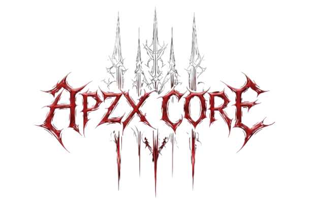

 

<h2 align="center">✠ 𝕿𝖍𝖊 𝕽𝖊𝖑𝖎𝖈𝖘 ✠</h2>

<table>
<tr>
<td align="center" width="50%">

Out now. Go break it.

</td>
<td align="center" width="50%">

Something is being summoned.

</td>
</tr>
</table>

<h2 align="center">✠ 𝕿𝖍𝖊 𝕬𝖗𝖘𝖊𝖓𝖆𝖑 ✠</h2>

 

<h2 align="center">✠ 𝕽𝖎𝖌𝖍𝖙 𝕹𝖔𝖜 ✠</h2>

| | |
|:--|:--|
| 🩸 **Shipping** | ClippieX |
| ⚔️ **Building** | Real-time dashboard with WebSockets and Redis |
| 🗡️ **Forging** | A TypeScript CLI toolchain |
| 📜 **Studying** | Rust and AI integrations |
| 🕯️ **Next** | NotchAura |

<h2 align="center">✠ 𝕿𝖍𝖊 𝕮𝖔𝖚𝖓𝖙 ✠</h2>

<h2 align="center">✠ 𝕿𝖍𝖊 𝕻𝖆𝖈𝖙 ✠</h2>

<table>
<tr>
<td align="center" width="50%">

**✦ I TAKE**

Freelance full-stack builds 
Technical consulting 
Open-source collabs

</td>
<td align="center" width="50%">

**✕ I REFUSE**

Spec work or free trials 
Unpaid gigs or "exposure" 
Equity-only offers

</td>
</tr>
</table>

 

